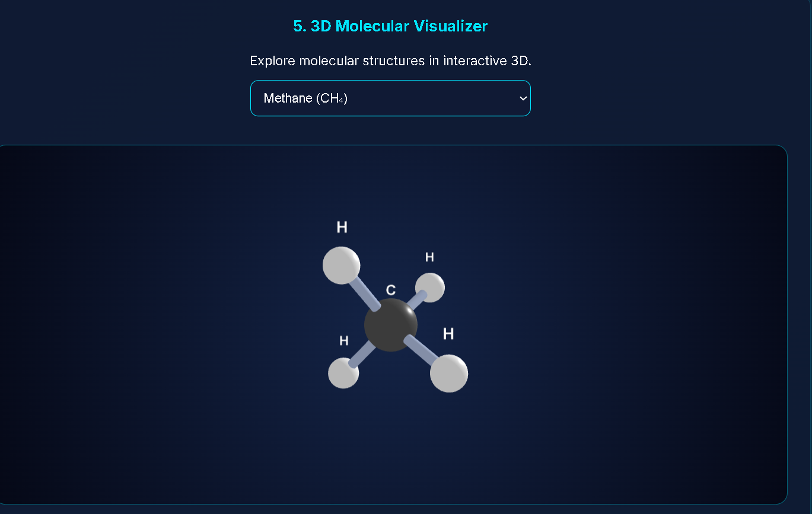

Interactive Reaction Balancer & Stoichiometry Calculator

A Python-based chemistry application that balances chemical equations and performs essential stoichiometric calculations through a FastAPI backend and an interactive web frontend.

Project Overview

This project combines chemistry principles with software development to automate chemical equation balancing and common stoichiometric calculations.

Users can enter chemical equations and molecular formulas through a web interface and receive calculated results from the backend API.

Features

Implemented Features

- Reaction Balancer: Balances chemical equations using SymPy.
- Molar Mass Calculator: Calculates molar mass in g/mol.
- Limiting Reagent Calculator: Identifies the limiting reactant.
- Theoretical Yield Calculator: Calculates theoretical product yield in moles and grams.
- Chemical Formula Validation: Checks element symbols against the periodic table.

Planned Features
- Expanded chemical reaction support.
- Additional stoichiometric calculations.

Technologies Used

Technology| Purpose
Python| Core calculation logic
FastAPI| Backend REST API
SymPy| Mathematical calculations and equation balancing
HTML| Frontend structure
CSS| User interface and styling
JavaScript| Frontend interactions and API communication
Pytest| Automated testing

Project Structure

Stoichiometry Calculator/
├── backend/
│   ├── __init__.py
│   ├── main.py
│   ├── balancer.py
│   └── stoichiometry.py
├── frontend/
│   ├── index.html
│   ├── style.css
│   └── script.js
├── tests/
│   ├── __init__.py
│   ├── test_balancer.py
│   └── test_stoichiometry.py
├── requirements.txt
├── .gitignore
└── README.md

Installation

1. Clone the repository

git clone YOUR_GITHUB_REPOSITORY_URL
cd "Stoichiometry Calculator"

2. Create a virtual environment

python -m venv venv

3. Activate the environment (Windows PowerShell)

.\venv\Scripts\Activate.ps1

4. Install dependencies

python -m pip install -r requirements.txt

Running the Application

Start the backend

uvicorn backend.main:app --reload

Backend address:

http://127.0.0.1:8000

API documentation

http://127.0.0.1:8000/docs

Start the frontend

Open "frontend/index.html" using the VS Code Live Server extension.

API Endpoints

Method| Endpoint| Function
POST| "/balance"| Balance chemical equations
POST| "/molar-mass"| Calculate molar mass
POST| "/limiting-reagent"| Identify limiting reagent
POST| "/theoretical-yield"| Calculate theoretical yield

Running Automated Tests

Run:

python -m pytest -v

Current test status: 10 automated tests passed.

Screenshots
## Screenshots

### 3D Molecular Visualizer

Future Improvements

- Expanded chemical formula and reaction validation.
- Support for more chemical reactions.
- Additional stoichiometric calculations.

5. Interactive 3D Molecular Visualizer

An interactive 3D visualization tool built using Three.js to explore molecular structures.

Supported Molecules:

- Water (H₂O)
- Carbon Dioxide (CO₂)
- Methane (CH₄)
- Ammonia (NH₃)

Features:

- Interactive 3D molecular structures.
- Dynamic molecule selection using a dropdown menu.
- Color-coded atoms for different chemical elements.
- Element labels displayed on atoms.
- Mouse-based 3D rotation.
- Mouse-wheel zoom controls.
- Molecular geometry information.
- Bond angle information.
- Total atom count.
- Dynamic molecular information panel.

Technologies: HTML, CSS, JavaScript, Three.js.

Author

Developed as a chemistry and software development project, combining chemical calculations, Python programming, REST API development, and frontend technologies.